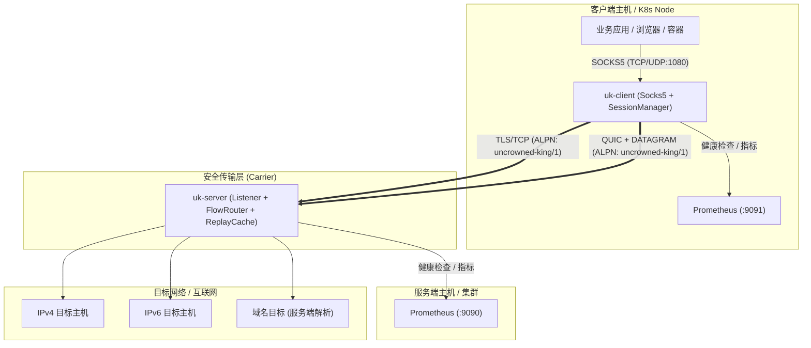
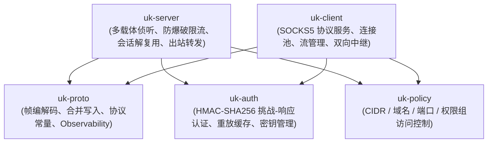
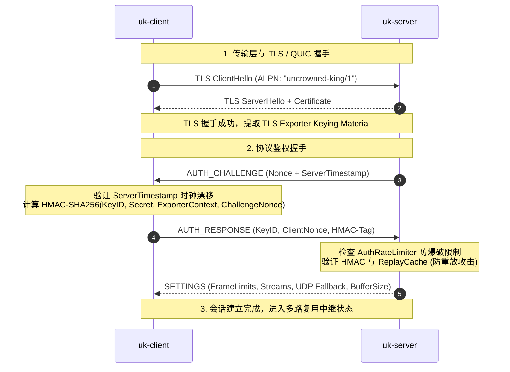

# Uncrowned King 架构设计与技术白皮书

本文档详细描述 Uncrowned King (UK) 安全多路复用隧道代理系统的系统架构、分层模型、帧生命周期、流量控制与安全设计。

---

## 1. 整体系统架构

Uncrowned King 采用 Client-Server 架构，客户端向内网提供标准的 SOCKS5 代理接口，将多个 TCP/UDP 流量通过单条或多条安全传输载体（TLS/TCP 或 QUIC）多路复用转发至服务端；服务端解复用后将流量代发至目标网络。

---

## 2. 工作区与 Crate 分层依赖关系

项目严格按职责划分为 5 个核心 Crate：

| Crate | 职责与设计原则 |
| :--- | :--- |
| **`uk-proto`** | 纯协议层：定义 Frame 格式、常量、零拷贝编码解码器、批量帧写入辅助函数与通用 HTTP 探针 |
| **`uk-auth`** | 鉴权安全层：基于 TLS Keying Material Exporter (RFC 5705) 的双向 HMAC 身份认证，带防重放与密钥零化 (`zeroize`) |
| **`uk-policy`** | 策略规则引擎：高性能 CIDR 前缀树、通配符域名匹配与 ACL 规则过滤 |
| **`uk-server`** | 服务端中继核心：支持 TLS 和 QUIC 双载体、防暴力破解速率限制 (`AuthRateLimiter`)、热重载与会话流控 |
| **`uk-client`** | 客户端中继核心：SOCKS5 服务器实现、自动保活、跨载体连接池负载均衡与重连降级 |

---

## 3. 会话建立与认证时序 (Handshake Sequence)

在传输任何数据流之前，客户端与服务端必须完成载体协商与凭证鉴权：

---

## 4. 多路复用流生命周期 (Flow Lifecycle)

### TCP 流生命周期
1. **打开流**：客户端发送 `TCP_OPEN(FlowID, TargetAddr)`。
2. **确认流**：服务端异步拨号目标地址，成功后回复 `TCP_OPEN_ACK(FlowID)`，若策略拒绝或目标不可达则返回对应错误码。
3. **数据传输**：双方使用 `TCP_DATA(FlowID, Payload)` 传输应用层载荷。
4. **半关闭与优雅终止**：一方读关闭时发送 `TCP_CLOSE(FlowID, Normal)`；双方关闭或异常超时后回收 `FlowID`。

### UDP 流生命周期
1. **关联协商**：SOCKS5 客户端发起 `UDP ASSOCIATE`。
2. **通道选择**：
   - **原生 QUIC DATAGRAM**：优先使用不可靠无序数据报，开销最低。
   - **UDP_DATA 流降级**：若载体为 TCP/TLS 或载荷超出最大数据报限制，使用 `UDP_DATA(FlowID, TargetAddr, Payload)` 帧进行中继。
3. **空闲流清理**：基于 `udp_flow_idle_timeout` 自动淘汰不活跃的 UDP 映射。

---

## 5. 安全威胁模型与防护策略

| 威胁场景 | UK 防护机制 |
| :--- | :--- |
| **中间人窃听与篡改** | 强制 TLS 1.3 / QUIC 加密通信，严格校验证书链与 ALPN |
| **凭证暴力破解** | `AuthRateLimiter` 滑动窗口限流，连续失败达阈值后自动封禁来源 IP |
| **重放攻击** | 结合 TLS Exporter 绑定会话密钥 + 时间戳窗口校验 + `ReplayCache` 唯一性缓存 |
| **内存泄露与 DoS 攻击** | 严格配置 `max_sessions`、`max_streams`、`max_buffered_bytes_per_session`，背压流控机制 |
| **内存凭证残留** | 密钥结构体全生命周期实现 `ZeroizeOnDrop`，使用完毕即刻安全覆写抹除 |
